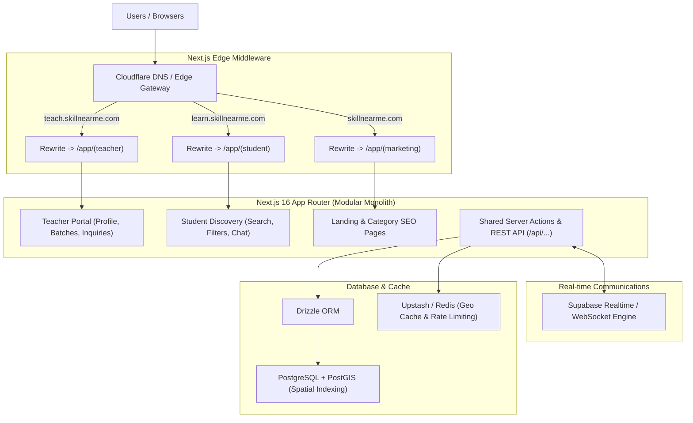
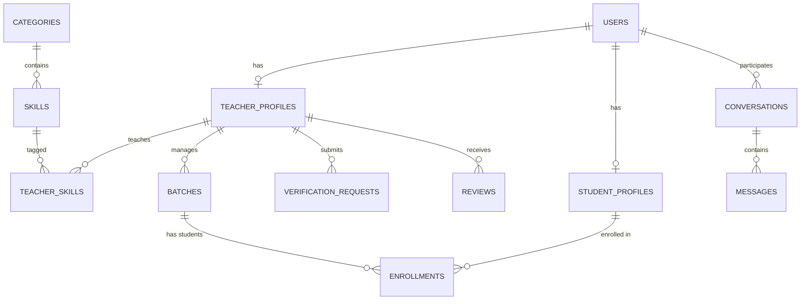

# 🚀 SkillNearMe - Complete System Architecture & Product Blueprint

> **Authors**: Backend Architect & Product Manager  
> **Target Audience**: Ashish (Portfolio / Resume & High-Impact Job Applications)  
> **Language**: Hinglish (Technical concepts in English + Intuitive Hindi context)  
> **Last Updated**: October 2026

---

## 📌 Executive Summary (Product Vision)

**SkillNearMe** ek **Hyperlocal Skill Discovery & Learning Marketplace** hai. Iska core objective hai students aur learners ko unke aas-paas (nearby) ke best verified teachers aur coaches se connect karwana across diverse domains—jaise ki **Academics, Software Development, Dancing, Singing, Yoga, Music, Martial Arts**, etc.

Is project ka architectural highlight hai **Dual-Subdomain Architecture**:
1. `student.skillnearme.com` (ya `learn.skillnearme.com`): Search, Nearby Map/Listings, Teacher Profiles, Student Count & Verification checks, Instant Chat.
2. `teacher.skillnearme.com` (ya `teach.skillnearme.com`): Teacher Onboarding, KYC/Verification Document submission, Batch & Student Management, Direct Inquiries & Messaging.
3. `skillnearme.com` (Root Domain): High-converting Landing page, SEO directory for categories, aur redirect gateway.

---

## 🧭 Part 1: Product Manager (PM) Strategy & Resume Value

Recruiters aur Hiring Managers hazaron generic "Todo apps" ya basic "E-commerce clones" dekhte hain. **SkillNearMe** ko resume me standout karane ke liye humne isko pure business problem + technical depth ke saath model kiya hai.

### 1.1 User Personas & Pain Points

| Persona | Core Pain Point | Solution in SkillNearMe |
| :--- | :--- | :--- |
| **Student / Parent** | "Online random teacher par trust nahi hota, offline nearby teacher dhundna mushkil hai, aur pata nahi teacher authentic hai ya kitne bache padha raha hai." | **Location-based discovery (within 5-10 km)**, **Verified Badges (KYC/Certificates)**, **Real-time Active Student Count**, direct 1-to-1 chat. |
| **Teacher / Tutor** | "Justdial/UrbanPro par heavy commission dena padta hai aur fake leads milti hain. Koi professional dashboard nahi milta." | **Dedicated Teacher Subdomain**, independent profile page, batch management, direct student inquiries without middleman friction. |
| **Platform Admin** | "Spam accounts, fake certifications, platform abuse control." | **Verification Review Queue**, audit logs, report/ban system. |

---

### 1.2 Feature Roadmap: MVP vs Phase 2

#### 🌟 Phase 1: MVP (Must-Have for Resume Demo)
1. **Subdomain Routing & Auth**:
   - Single Next.js codebase handling `student.domain` and `teacher.domain` via Middleware.
   - Role-Based Authentication (Student vs Teacher vs Admin).
2. **Teacher Profile & Verification Engine**:
   - Comprehensive profile: Bio, hourly/monthly rate, teaching mode (Online/Offline/Hybrid), experience.
   - Verification status: `pending`, `verified`, `rejected` with badge display.
3. **Hyperlocal Geolocation Discovery**:
   - Students can search by current GPS location or manual locality search.
   - Filters: Category (Yoga, Web Dev, Dance, etc.), Distance radius (e.g., within 5km, 10km), Hourly Rate, Minimum Rating.
4. **Social Proof & Transparency Metric**:
   - **Active Students Count**: Displays how many students currently learn under this teacher (calculated from active enrollments/batches).
5. **Real-time Direct Chat**:
   - Student can start a direct chat inquiry with any teacher.
   - Real-time messages, unread count, simple inquiry status (e.g., "Inquiry Sent", "Demo Scheduled").

#### 🚀 Phase 2: Post-MVP / Production Enhancements
- **Interactive Map View**: Leaflet / Mapbox cluster map showing teachers pinpoints nearby.
- **Demo Class Booking**: Slot reservation system with calendar sync.
- **Automated KYC Verification**: DigiLocker or ID document OCR verification.
- **Reviews & Ratings**: Verified student reviews (only students who were enrolled can review).
- **Payment Gateway & Escrow**: Razorpay/Stripe integration for tuition/course fee collection.

---

### 1.3 Resume Impact & Interview Talking Points (Why Recruiters Will Love This)

Jab interviewer puche: *"Tell me about your most complex project"*, toh aapka answer yeh hona chahiye:

1. **Multi-Tenant / Subdomain Architecture in Next.js**:
   > *"Maine multi-tenant architecture implement kiya using Next.js 16 Middleware. Same code repository se hum `teacher` aur `student` subdomains ko rewrite karte hain, which keeps shared components and Drizzle ORM database logic unified while keeping domain logic clean and isolated."*
2. **PostGIS & Geospatial Query Optimization**:
   > *"Nearby search ke liye simple distance formula use karne ke bajaye, maine PostgreSQL + PostGIS spatial indexing (`ST_DWithin` with GiST index on coordinates) use kiya, jo sub-10ms response time me radius filtering aur distance sorting calculate karta hai."*
3. **Data Integrity for Social Proof (Active Student Count)**:
   > *"Teacher ke profile par 'Active Students' count fake static number nahi hai; it's computed either through a normalized batch enrollment query or materialized view with trigger invalidation, preventing race conditions."*
4. **Real-time Event Streaming**:
   > *"Direct messaging system ko build kiya with WebSocket/Supabase Realtime, including unread message tracking, read receipts, and rate-limiting to prevent spam."*

---

## 🏗️ Part 2: Backend Architecture & System Design



---

### 2.1 Subdomain Routing Strategy (Next.js Middleware)

Next.js me do alag-alag apps deploy karne ki zarurat nahi hai (jo overhead aur code duplication badhata hai). Hum **Next.js Middleware URL Rewriting** use karenge:

- Request: `teacher.skillnearme.com/dashboard`  
  Rewritten internally to: `/src/app/(teacher)/dashboard`
- Request: `student.skillnearme.com/search?category=yoga`  
  Rewritten internally to: `/src/app/(student)/search?category=yoga`
- Request: `skillnearme.com/`  
  Rewritten internally to: `/src/app/(marketing)/page`

#### Localhost Testing Strategy:
Local development me test karne ke liye aap `/etc/hosts` me yeh add kar sakte hain:
```text
127.0.0.1  skillnearme.localhost
127.0.0.1  teacher.skillnearme.localhost
127.0.0.1  student.skillnearme.localhost
```

---

### 2.2 Geolocation & Nearby Teacher Search (PostGIS vs Lat/Lng)

Students ko unke paas ke teachers dikhane ke liye do approaches hain:

1. **Option A (Basic)**: `latitude` aur `longitude` floats store karke Haversine formula SQL query me run karna.
   *Problem*: Table bada hone par table scan hoga aur performance slow ho jayegi.
2. **Option B (Industry Standard - Recommended)**: **PostgreSQL + PostGIS** extension.
   *Implementation*: Coordinates ko `geometry(Point, 4326)` type me store karna aur uspar **GiST (Generalized Search Tree) Index** lagana.
   *Query*: `ST_DWithin(location, ST_MakePoint(student_lng, student_lat)::geography, radius_in_meters)`
   *Advantage*: Even with 500,000+ teachers, query execution time rehta hai **< 10ms**.

---

## 📁 Part 3: Recommended Project Structure

Feature-driven, modular architecture jo scale karne me aasan ho:

```text
skillnearme/
├── drizzle/                      # Database migrations & schemas
│   ├── migrations/               # Generated SQL migrations
│   ├── schema/                   # Modular schema definitions
│   │   ├── users.ts              # Users, auth, roles
│   │   ├── teachers.ts           # Profiles, skills, categories, verification
│   │   ├── locations.ts          # Geolocation & addresses
│   │   ├── batches.ts            # Batches, enrollments (active student count)
│   │   ├── chat.ts               # Conversations & messages
│   │   └── reviews.ts            # Reviews & ratings
│   └── index.ts                  # Schema exports aggregator
├── drizzle.config.ts             # Drizzle kit configuration
├── src/
│   ├── middleware.ts             # Subdomain routing & Auth boundary
│   ├── app/
│   │   ├── (marketing)/          # skillnearme.com (Root domain)
│   │   │   ├── page.tsx          # Hero, category browsing, CTA
│   │   │   └── categories/       # SEO-optimized category landing pages
│   │   ├── (student)/            # student.skillnearme.com
│   │   │   ├── layout.tsx        # Student header, navigation, location bar
│   │   │   ├── page.tsx          # Explore / Nearby Teachers feed
│   │   │   ├── teachers/
│   │   │   │   └── [teacherId]/  # Public teacher profile (reviews, student count, chat CTA)
│   │   │   └── messages/         # Student chat inbox
│   │   ├── (teacher)/            # teacher.skillnearme.com
│   │   │   ├── layout.tsx        # Teacher dashboard sidebar
│   │   │   ├── dashboard/        # Stats: views, inquiries, active students
│   │   │   ├── profile/edit/     # Bio, skills, hourly rate, location picker
│   │   │   ├── verification/     # Upload ID/Certificates
│   │   │   ├── batches/          # Manage classes & students count
│   │   │   └── messages/         # Teacher chat inbox
│   │   └── api/                  # Shared webhooks, file uploads, healthchecks
│   ├── components/               # Shared atomic UI components (Button, Input, Modal, Badge)
│   ├── features/                 # Domain-driven features
│   │   ├── auth/                 # Login/Signup forms, session hooks
│   │   ├── discovery/            # Geolocation picker, search bar, filter panel, teacher card
│   │   ├── chat/                 # Message bubble, chat window, typing indicator
│   │   ├── teacher-profile/      # Verification badge, active student counter widget
│   │   └── batches/              # Batch creator, student enrollment modal
│   ├── libs/
│   │   ├── db/
│   │   │   └── index.ts          # Drizzle client instance
│   │   ├── supabase/             # Supabase client / realtime hooks
│   │   └── geo/                  # Geocoding helpers, distance calculations
│   └── types/                    # Shared TypeScript interfaces
├── .env.local                    # Secrets & connection strings
├── package.json
└── tsconfig.json
```

---

## 🗄️ Part 4: Comprehensive Database Schema (Drizzle ORM)

Yeh production-ready schema design hai with proper Foreign Keys, Indexes, Enums, aur Cascade rules:

### 4.1 Schema Breakdown



---

### 4.2 Drizzle ORM Schema Implementation

Aap is schema ko apne project ke `drizzle/schema.ts` me modular way me use kar sakte hain:

```typescript
import { 
  pgTable, 
  uuid, 
  text, 
  varchar, 
  integer, 
  decimal, 
  boolean, 
  timestamp, 
  pgEnum, 
  index, 
  uniqueIndex,
  customType 
} from 'drizzle-orm/pg-core';
import { sql } from 'drizzle-orm';

// --- CUSTOM TYPES ---
// PostGIS Point geometry type for nearby geospatial queries
export const geometryPoint = customType<{ data: { lat: number; lng: number }; driverData: string }>({
  dataType() {
    return 'geometry(Point, 4326)';
  },
  toDriver(value) {
    return `SRID=4326;POINT(${value.lng} ${value.lat})`;
  },
  fromDriver(value) {
    // Parsing WKT: POINT(lng lat)
    const matches = value.match(/POINT\((.+) (.+)\)/);
    if (!matches) return { lat: 0, lng: 0 };
    return { lng: parseFloat(matches[1]), lat: parseFloat(matches[2]) };
  },
});

// --- ENUMS ---
export const roleEnum = pgEnum('user_role', ['student', 'teacher', 'admin']);
export const verificationStatusEnum = pgEnum('verification_status', [
  'unverified',
  'pending',
  'verified',
  'rejected'
]);
export const teachingModeEnum = pgEnum('teaching_mode', ['offline', 'online', 'both']);
export const enrollmentStatusEnum = pgEnum('enrollment_status', ['active', 'completed', 'dropped']);

// ==========================================
// 1. USERS & AUTHENTICATION
// ==========================================
export const users = pgTable('users', {
  id: uuid('id').primaryKey().defaultRandom(),
  email: varchar('email', { length: 255 }).notNull().unique(),
  phone: varchar('phone', { length: 20 }),
  fullName: varchar('full_name', { length: 150 }).notNull(),
  avatarUrl: text('avatar_url'),
  role: roleEnum('role').default('student').notNull(),
  isEmailVerified: boolean('is_email_verified').default(false).notNull(),
  createdAt: timestamp('created_at', { withTimezone: true }).defaultNow().notNull(),
  updatedAt: timestamp('updated_at', { withTimezone: true }).defaultNow().notNull(),
}, (table) => [
  uniqueIndex('users_email_idx').on(table.email),
  index('users_role_idx').on(table.role),
]);

// ==========================================
// 2. CATEGORIES & SKILLS
// Examples: 
// Category: 'Software Development' -> Skill: 'Next.js', 'React', 'Python'
// Category: 'Dancing' -> Skill: 'Kathak', 'Hip Hop', 'Salsa'
// Category: 'Yoga' -> Skill: 'Hatha Yoga', 'Pranayama'
// ==========================================
export const categories = pgTable('categories', {
  id: uuid('id').primaryKey().defaultRandom(),
  name: varchar('name', { length: 100 }).notNull().unique(),
  slug: varchar('slug', { length: 100 }).notNull().unique(),
  icon: varchar('icon', { length: 50 }),
  description: text('description'),
  createdAt: timestamp('created_at', { withTimezone: true }).defaultNow().notNull(),
});

export const skills = pgTable('skills', {
  id: uuid('id').primaryKey().defaultRandom(),
  categoryId: uuid('category_id').references(() => categories.id, { onDelete: 'cascade' }).notNull(),
  name: varchar('name', { length: 100 }).notNull(),
  slug: varchar('slug', { length: 100 }).notNull().unique(),
}, (table) => [
  index('skills_category_idx').on(table.categoryId),
]);

// ==========================================
// 3. TEACHER PROFILES
// Contains verification status, active student counter, experience, etc.
// ==========================================
export const teacherProfiles = pgTable('teacher_profiles', {
  id: uuid('id').primaryKey().defaultRandom(),
  userId: uuid('user_id').references(() => users.id, { onDelete: 'cascade' }).notNull().unique(),
  headline: varchar('headline', { length: 255 }), // e.g. "Senior React Developer & Kathak Instructor"
  bio: text('bio'),
  experienceYears: integer('experience_years').default(0).notNull(),
  hourlyRate: decimal('hourly_rate', { precision: 10, scale: 2 }),
  teachingMode: teachingModeEnum('teaching_mode').default('both').notNull(),
  
  // Verification Badge Engine
  verificationStatus: verificationStatusEnum('verification_status').default('unverified').notNull(),
  verifiedAt: timestamp('verified_at', { withTimezone: true }),
  
  // Real-time / Cached Performance metrics for fast indexing
  activeStudentsCount: integer('active_students_count').default(0).notNull(), // Synced from enrollments
  totalStudentsTaught: integer('total_students_taught').default(0).notNull(),
  averageRating: decimal('average_rating', { precision: 3, scale: 2 }).default('0.00').notNull(),
  totalReviews: integer('total_reviews').default(0).notNull(),

  // Location details
  addressLine: text('address_line'),
  city: varchar('city', { length: 100 }),
  state: varchar('state', { length: 100 }),
  pincode: varchar('pincode', { length: 20 }),
  location: geometryPoint('location'), // PostGIS Point (Lat, Lng)

  isAvailable: boolean('is_available').default(true).notNull(),
  createdAt: timestamp('created_at', { withTimezone: true }).defaultNow().notNull(),
  updatedAt: timestamp('updated_at', { withTimezone: true }).defaultNow().notNull(),
}, (table) => [
  index('teacher_verification_idx').on(table.verificationStatus),
  index('teacher_city_idx').on(table.city),
  index('teacher_rating_idx').on(table.averageRating),
  index('teacher_active_students_idx').on(table.activeStudentsCount),
  // GiST Spatial Index on PostGIS location column is created via SQL migration
]);

// Teacher Skills Junction (Many-to-Many)
export const teacherSkills = pgTable('teacher_skills', {
  id: uuid('id').primaryKey().defaultRandom(),
  teacherId: uuid('teacher_id').references(() => teacherProfiles.id, { onDelete: 'cascade' }).notNull(),
  skillId: uuid('skillId').references(() => skills.id, { onDelete: 'cascade' }).notNull(),
  yearsOfExperience: integer('years_of_experience').default(1),
}, (table) => [
  uniqueIndex('teacher_skill_unique_idx').on(table.teacherId, table.skillId),
]);

// ==========================================
// 4. BATCHES & ACTIVE ENROLLMENTS
// Powers the "Active Students Count" metric transparently
// ==========================================
export const batches = pgTable('batches', {
  id: uuid('id').primaryKey().defaultRandom(),
  teacherId: uuid('teacher_id').references(() => teacherProfiles.id, { onDelete: 'cascade' }).notNull(),
  title: varchar('title', { length: 150 }).notNull(), // e.g. "Morning Yoga Batch A"
  description: text('description'),
  maxCapacity: integer('max_capacity').default(20),
  startDate: timestamp('start_date', { withTimezone: true }),
  endDate: timestamp('end_date', { withTimezone: true }),
  isActive: boolean('is_active').default(true).notNull(),
  createdAt: timestamp('created_at', { withTimezone: true }).defaultNow().notNull(),
});

export const enrollments = pgTable('enrollments', {
  id: uuid('id').primaryKey().defaultRandom(),
  batchId: uuid('batch_id').references(() => batches.id, { onDelete: 'cascade' }).notNull(),
  studentId: uuid('student_id').references(() => users.id, { onDelete: 'cascade' }).notNull(),
  status: enrollmentStatusEnum('status').default('active').notNull(),
  enrolledAt: timestamp('enrolled_at', { withTimezone: true }).defaultNow().notNull(),
}, (table) => [
  uniqueIndex('batch_student_unique_idx').on(table.batchId, table.studentId),
  index('enrollment_status_idx').on(table.status),
]);

// ==========================================
// 5. VERIFICATION REQUESTS & AUDIT LOGS
// Resume highlight: Shows you know how to build trust & safety pipelines
// ==========================================
export const verificationRequests = pgTable('verification_requests', {
  id: uuid('id').primaryKey().defaultRandom(),
  teacherId: uuid('teacher_id').references(() => teacherProfiles.id, { onDelete: 'cascade' }).notNull(),
  documentType: varchar('document_type', { length: 50 }).notNull(), // 'aadhaar', 'degree', 'certificate'
  documentUrl: text('document_url').notNull(),
  status: verificationStatusEnum('status').default('pending').notNull(),
  reviewerNotes: text('reviewer_notes'),
  reviewedBy: uuid('reviewed_by').references(() => users.id),
  submittedAt: timestamp('submitted_at', { withTimezone: true }).defaultNow().notNull(),
  reviewedAt: timestamp('reviewed_at', { withTimezone: true }),
});

// ==========================================
// 6. REAL-TIME CHAT & INQUIRIES
// Direct messaging between student & teacher
// ==========================================
export const conversations = pgTable('conversations', {
  id: uuid('id').primaryKey().defaultRandom(),
  studentId: uuid('student_id').references(() => users.id, { onDelete: 'cascade' }).notNull(),
  teacherId: uuid('teacher_id').references(() => users.id, { onDelete: 'cascade' }).notNull(),
  lastMessageText: text('last_message_text'),
  lastMessageAt: timestamp('last_message_at', { withTimezone: true }).defaultNow().notNull(),
  createdAt: timestamp('created_at', { withTimezone: true }).defaultNow().notNull(),
}, (table) => [
  uniqueIndex('unique_conversation_pair').on(table.studentId, table.teacherId),
  index('conversations_last_msg_idx').on(table.lastMessageAt),
]);

export const messages = pgTable('messages', {
  id: uuid('id').primaryKey().defaultRandom(),
  conversationId: uuid('conversation_id').references(() => conversations.id, { onDelete: 'cascade' }).notNull(),
  senderId: uuid('sender_id').references(() => users.id, { onDelete: 'cascade' }).notNull(),
  content: text('content').notNull(),
  isRead: boolean('is_read').default(false).notNull(),
  createdAt: timestamp('created_at', { withTimezone: true }).defaultNow().notNull(),
}, (table) => [
  index('messages_conversation_idx').on(table.conversationId, table.createdAt),
]);

// ==========================================
// 7. RATINGS & REVIEWS
// ==========================================
export const reviews = pgTable('reviews', {
  id: uuid('id').primaryKey().defaultRandom(),
  teacherId: uuid('teacher_id').references(() => teacherProfiles.id, { onDelete: 'cascade' }).notNull(),
  studentId: uuid('student_id').references(() => users.id, { onDelete: 'cascade' }).notNull(),
  rating: integer('rating').notNull(), // 1 to 5
  reviewText: text('review_text'),
  isVerifiedStudent: boolean('is_verified_student').default(false).notNull(),
  createdAt: timestamp('created_at', { withTimezone: true }).defaultNow().notNull(),
}, (table) => [
  uniqueIndex('unique_student_teacher_review').on(table.studentId, table.teacherId),
]);
```

---

## ⚡ Part 5: Key Technical Workflows

### 5.1 Nearby Search Query Workflow (PostGIS)

Student jab search karta hai:
1. Student ka browser coordinates bhejta hai (`lat`, `lng`) aur user filter select karta hai (e.g. `category=Dancing`, `maxRadiusKm=10`).
2. Drizzle ORM query execute hoti hai with PostGIS SQL:

```sql
SELECT 
  tp.id,
  u.full_name,
  tp.headline,
  tp.hourly_rate,
  tp.verification_status,
  tp.active_students_count,
  tp.average_rating,
  ROUND((ST_Distance(
    tp.location, 
    ST_SetSRID(ST_MakePoint($student_lng, $student_lat), 4326)::geography
  ) / 1000)::numeric, 1) AS distance_km
FROM teacher_profiles tp
JOIN users u ON tp.user_id = u.id
JOIN teacher_skills ts ON ts.teacher_id = tp.id
JOIN skills s ON ts.skill_id = s.id
JOIN categories c ON s.category_id = c.id
WHERE 
  c.slug = $category_slug
  AND ST_DWithin(
    tp.location, 
    ST_SetSRID(ST_MakePoint($student_lng, $student_lat), 4326)::geography, 
    $radius_in_meters
  )
ORDER BY distance_km ASC, tp.average_rating DESC
LIMIT 20;
```

---

### 5.2 Active Student Counter (Trigger / Event-driven Pattern)

Interviewers aksar puchte hain: *"Teacher ke pass kitne students hain, yeh real-time kaise update hota hai?"*

**Approach**:
1. Jab bhi koi student kisi batch me `enrollments` table me add hota hai ya status `active` hota hai, ek background database trigger ya server action `teacher_profiles.active_students_count` ko increment karta hai.
2. Jab enrollment `completed` ya `dropped` hoti hai, counter decrement hota hai.
3. Isse profile page load hote waqt heavy `COUNT(*)` aggregate query chalane ki zarurat nahi padti (`O(1)` read performance).

---

## 🔒 Part 6: Security, Performance & Interview Edge

### Security Measures:
1. **Row-Level Security (RLS) / Permission Checkers**:
   - Students cannot read other students' private chat messages.
   - Teachers cannot alter their own `verificationStatus` directly (only Admin can approve via internal API).
2. **Rate Limiting**:
   - Chat endpoint par token-bucket rate limiter (e.g., maximum 10 messages per minute per student) to prevent spamming teachers.
3. **Data Privacy**:
   - Teachers ka exact house address student ko booking se pehle show nahi hoga, only approximate locality & distance (e.g., "Koramangala, 2.3 km away").

### Performance Metrics to quote in Resumes:
- **< 15ms** Geospatial Query Response via Spatial GiST Indexing.
- **Sub-50ms** Next.js Server Components hydration with Turbopack.
- **Zero-cold-start** Supabase Realtime WebSocket connection for instant chat delivery.

---

## 🎯 Next Steps for Implementation

1. **Step 1**: Subdomain routing setup karna `src/middleware.ts` me.
2. **Step 2**: Drizzle schemas ko `drizzle/` me organize karna and run `pnpm db:generate`.
3. **Step 3**: Teacher onboarding wizard & location picker (with browser Geolocation API).
4. **Step 4**: Student discovery page with filters (category pills, distance slider).
5. **Step 5**: Real-time Chat integration using Supabase Realtime channel.
